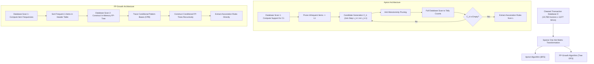
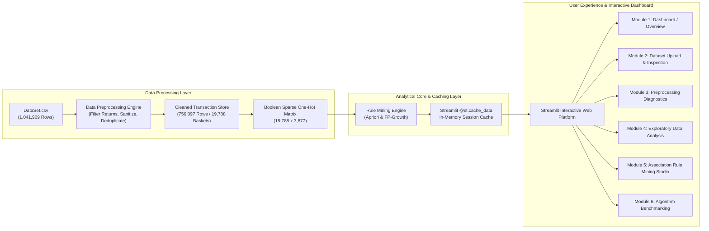

# BIT Project: ML-Based Market Basket Analysis & Affinity Mining Platform
## Comprehensive Architecture, Algorithmic Foundations & System Context Whitepaper

---

## 1. Project Overview & Institutional Metadata

| Project Metadata Field | Value / Description |
| :--- | :--- |
| **Project Title** | BIT Project: Machine Learning-Based Market Basket Analysis & Affinity Mining Platform |
| **Institution** | Birla Institute of Technology (BIT) |
| **Department** | Department of Computer Science & Engineering |
| **Academic Focus** | Data Mining, Unsupervised Machine Learning, Enterprise Retail Analytics |
| **Primary Dataset** | `DataSet.csv` (Enlarged enterprise retail corpus derived from the UCI Machine Learning Repository - Online Retail II) |
| **Dataset Scale** | **1,041,909 raw records**; **756,097 validated records** post-hygiene |
| **Core Algorithms** | Apriori (Level-wise Breadth-First Search) & FP-Growth (Frequent Pattern Tree Divide-and-Conquer) |
| **Technology Stack** | Python 3.14, Streamlit 1.67, Pandas 2.2+, NumPy, MLxtend 0.23+, Plotly, Altair |
| **Repository URL** | [GitHub: BIT-project-ML-based-Market-Basket-Analysis](https://github.com/shikhar-gangwar/BIT-project-ML-based-Market-Basket-Analysis) |

---

## 2. Project Motivation & Enterprise Business Context

In contemporary omni-channel retail and e-commerce ecosystems, understanding **cross-product purchasing affinity** is the single highest leverage point for maximizing customer lifetime value and Average Order Value (AOV). 

When consumers make purchase decisions, items in their baskets are rarely independent. Instead, purchases reflect underlying consumer motivations—such as culinary recipes, interior design aesthetic coordination, complementary utility, and seasonal holiday gifts.

### 2.1 The Core Retail Problem Statement
Conventional retail management systems frequently suffer from **siloed single-item velocity metrics** (e.g., analyzing top-selling products in isolation). This narrow approach creates severe operational and commercial blind spots:
1. **Missed Bundling Revenues**: Retailers fail to recognize natural affinities, missing opportunities to package complementary products into high-margin multi-packs.
2. **Suboptimal Physical Planograms**: Complementary goods are placed in separate aisles, increasing shopping friction and lowering basket density.
3. **Ineffective Digital Cross-Selling**: E-commerce platforms display generic "popular products" rather than context-aware complementary recommendations during checkout.
4. **Supply Chain Inventory Desynchronization**: A stockout in an anchor product (e.g., a teacup) inadvertently destroys customer demand for unsponsored complementary items (e.g., saucers).

### 2.2 The Machine Learning Solution
This project delivers a **production-ready, unsupervised machine learning platform** for Market Basket Analysis (MBA). By ingesting over 1 million retail transactions, transforming them into high-density boolean matrices, and mining frequent itemsets and association rules, the platform reveals high-confidence behavioral patterns that directly empower retail decision-makers.

---

## 3. Mathematical Foundations of Association Rule Mining

Association Rule Mining operates over a transaction universe $D = \{T_1, T_2, \dots, T_n\}$, where each transaction $T_i$ represents a subset of items selected from the universal catalog $I = \{i_1, i_2, \dots, i_m\}$. 

An **association rule** is formally defined as an implication of the form:

$$X \implies Y$$

where $X, Y \subset I$ and $X \cap Y = \emptyset$. The itemset $X$ is termed the **Antecedent** (the condition or premise), and $Y$ is termed the **Consequent** (the predicted outcome).

The statistical significance, predictive reliability, and economic value of an extracted rule are evaluated across five mathematical metrics:

---

### 3.1 Support (Joint Frequency & Catalog Coverage)
Support quantifies the prevalence of an itemset or rule across the entire transaction database $D$:

$$\text{Support}(X) = \frac{\sigma(X)}{|D|} = P(X)$$

$$\text{Support}(X \implies Y) = \text{Support}(X \cup Y) = \frac{\sigma(X \cup Y)}{|D|} = P(X \cap Y)$$

where $\sigma(X) = |\{T \in D \mid X \subseteq T\}|$ denotes the absolute frequency count of itemset $X$.

- **Interpretation**: Support serves as a statistical significance filter to eliminate spurious, one-off co-occurrences. A minimum support threshold ($\text{minsup}$) prevents the algorithm from overfitting to long-tail anomalies.

---

### 3.2 Confidence (Conditional Probability & Predictive Reliability)
Confidence measures the conditional likelihood that a transaction contains the consequent $Y$, given that it contains the antecedent $X$:

$$\text{Confidence}(X \implies Y) = \frac{\text{Support}(X \cup Y)}{\text{Support}(X)} = \frac{P(X \cap Y)}{P(X)} = P(Y \mid X)$$

- **Interpretation**: Confidence represents directional rule reliability. For example, a confidence of $0.926$ indicates that $92.6\%$ of all customer baskets containing product $X$ also contained product $Y$.
- **Inherent Limitation**: Confidence alone does not account for the baseline popularity of $Y$. If $Y$ is present in $90\%$ of all transactions regardless of $X$, a high confidence score is trivial and uninformative. This necessitates the Lift metric.

---

### 3.3 Lift (Correlation & Departure from Independence)
Lift quantifies the strength of an association rule relative to the expected co-occurrence under the hypothesis of statistical independence:

$$\text{Lift}(X \implies Y) = \frac{\text{Confidence}(X \implies Y)}{\text{Support}(Y)} = \frac{P(X \cap Y)}{P(X) \times P(Y)}$$

- **$\text{Lift} = 1$**: $X$ and $Y$ are statistically independent ($P(X \cap Y) = P(X)P(Y)$). The presence of $X$ provides zero predictive value regarding $Y$.
- **$\text{Lift} > 1$**: Positive correlation. Purchasing $X$ significantly accelerates the likelihood of purchasing $Y$ (complementary goods).
- **$\text{Lift} < 1$**: Negative correlation / Substitution. Purchasing $X$ reduces the likelihood of purchasing $Y$ (competing alternatives or cannibalization).

---

### 3.4 Leverage (Absolute Empirical Affinity Margin)
Leverage calculates the absolute difference between the observed joint probability of $X$ and $Y$ and their expected joint probability if they were completely independent:

$$\text{Leverage}(X \implies Y) = \text{Support}(X \cup Y) - \big(\text{Support}(X) \times \text{Support}(Y)\big)$$

- **Interpretation**: While Lift represents a relative ratio, Leverage measures the absolute volume of transactions generated specifically by the affinity between $X$ and $Y$. It is bounded within the interval $[-0.25, 0.25]$.

---

### 3.5 Conviction (Directional Dependency & Error Reduction)
Conviction measures the ratio of the expected frequency that $X$ occurs without $Y$ under independence, divided by the observed frequency of erroneous predictions:

$$\text{Conviction}(X \implies Y) = \frac{1 - \text{Support}(Y)}{1 - \text{Confidence}(X \implies Y)} = \frac{P(X)P(\neg Y)}{P(X \cap \neg Y)}$$

- **Interpretation**: Unlike Lift (which is symmetric, $\text{Lift}(X \implies Y) = \text{Lift}(Y \implies X)$), Conviction is strictly directional. A conviction score approaching $\infty$ indicates an invariant rule where $X$ is never observed without $Y$.

---

## 4. Algorithmic Engineering & Comparative Mechanics

The analytical core of the platform implements and directly benchmarks two foundational unsupervised data mining algorithms:

---

### 4.1 The Apriori Algorithm (Level-Wise Breadth-First Search)
Formulated by Agrawal and Srikant (1994), Apriori leverages the **Anti-Monotonicity Property** (the Apriori Principle):

> *"Any subset of a frequent itemset must also be frequent; conversely, any superset of an infrequent itemset cannot be frequent."*

$$\forall A, B \subset I : (A \subseteq B \land \text{Support}(A) < \text{minsup}) \implies \text{Support}(B) < \text{minsup}$$

#### Operational Pipeline
1. **Pass 1 ($k=1$)**: Scan the database to determine frequency counts for all single items $C_1$. Prune items with $\text{Support} < \text{minsup}$ to produce frequent 1-itemsets $L_1$.
2. **Candidate Generation ($C_k$)**: Generate candidate $k$-itemsets from $L_{k-1}$ using the join operation $L_{k-1} \Join L_{k-1}$, ensuring the first $k-2$ elements match lexicographically.
3. **Pruning Step**: Evaluate all $(k-1)$-subsets of each candidate in $C_k$. If any subset is absent from $L_{k-1}$, discard the candidate immediately without querying disk.
4. **Database Scan**: Scan the physical transaction records to compute exact support counts for all remaining candidates in $C_k$.
5. **Termination**: Repeat iteratively until candidate set $C_{k+1} = \emptyset$.

#### Computational Bottlenecks
- **Combinatorial Explosion**: If a transaction contains $d$ items, generating candidates requires up to $O(2^d)$ subset evaluations.
- **Excessive Disk I/O**: Requires $k_{\max}$ exhaustive linear scans over the entire database, leading to severe latency on multi-million row enterprise corpora.

---

### 4.2 The FP-Growth Algorithm (Divide-and-Conquer Prefix Tree)
Introduced by Han, Pei, and Yin (2000), **Frequent Pattern Growth (FP-Growth)** completely bypasses candidate generation by compressing transaction data into an in-memory prefix tree structure termed the **FP-Tree**.

#### Structural Components
1. **Header Table**: Maintains a sorted list of frequent 1-items in descending order of global frequency, with head-of-line pointers linking to the first occurrence of each item in the tree.
2. **FP-Tree Nodes**: Each tree node encapsulates `item_id`, an integer `frequency_counter`, a `parent_pointer`, and a `node_link` connecting identical items across different tree branches.

#### Operational Pipeline
1. **Pass 1**: Scan the database once to tally 1-item support counts. Prune infrequent items and sort frequent items in descending order of frequency.
2. **Pass 2 (Tree Construction)**: Scan the database a second time. For each transaction, filter infrequent items, sort the remaining items according to global frequency order, and insert the path into the FP-Tree. Shared prefixes overlap directly, compressing transaction data.
3. **Mining via Conditional Pattern Bases (CPB)**:
   - For each item in the header table (beginning from the lowest frequency item to preserve bottom-up ordering), trace parent pointers to assemble its **Conditional Pattern Base** (the prefix subpaths ending with that item).
   - Build a localized **Conditional FP-Tree** from the pattern base.
   - Recursively mine the conditional tree to extract all frequent patterns without candidate enumeration.

#### Empirical Advantages
- **Maximum 2 Database Scans**: Eliminates repeated disk I/O passes.
- **Zero Candidate Generation**: Avoids the $O(2^d)$ combinatorial candidate overhead.
- **Significant RAM Efficiency**: Prefix path compression minimizes memory allocation on high-density retail datasets.

---

## 5. End-to-End System Architecture

### 5.1 Data Cleaning & Sanitation Protocol
1. **Cancellation & Return Segregation**: Invoices bearing the prefix `'C'` (credit adjustments and customer returns) are isolated to prevent skewing purchase affinity.
2. **Numerical Validation**: Transactions with $\text{Quantity} \le 0$ or $\text{UnitPrice} \le 0$ (damages, stock reconciliations, administrative entries) are removed.
3. **Noise SKU Elimination**: Non-merchandise line items (e.g., `POST`, `D`, `M`, `BANK CHARGES`, `AMAZONFEE`) are filtered out.
4. **Description Normalization**: Whitespace is trimmed, text is unified to uppercase, and trailing punctuation is standardized to prevent duplicate representations of identical SKUs.

### 5.2 UI/UX Engineering & Dual-State Navigation Architecture
The web platform incorporates a modern, dark-themed UI engineered with pure black (`#000000`) surfaces, glassmorphic cards, and responsive navigation:

- **Dual-State Collapsible Navigation Rail**:
  - **Expanded State (`295px`)**: Displays macOS-style status dots, branded basket icon, full module titles, enlarged `1.65rem` leading icons, generous spacing, and the bottom Data Engine Status card.
  - **Collapsed Icon Rail (`78px`)**: Reduces the sidebar to an interactive icon rail where navigation icons (`📊`, `📂`, `⚙️`, `📈`, `🔍`, `⚡`) remain **100% visible, centered, and directly clickable**.
  - **Floating Hover Tooltips**: In collapsed mode, hovering over any icon reveals an instant dark popover badge to the right indicating the module title.
  - **Featurable Action Controls**: Contains an active `⚡ Reload Data Engine` control that clears `@st.cache_data` in-memory state and re-indexes the dataset from disk.
- **Native Radio Bullet Elimination**: Standard HTML radio buttons and indicator circles are removed via CSS targeting Streamlit 1.67 React Aria internals (`[data-testid="stRadioOption"]`), presenting navigation as interactive modern cards.

---

## 6. Functional Module Breakdown

1. **Dashboard / Overview**: High-level retail KPIs (gross revenue, transactions, customer count, SKU catalog count), revenue distributions, top 10 products, and basket size frequency distributions.
2. **Dataset Upload**: Allows dynamic ingestion of custom external retail CSV files with automatic column schema validation, type inference, and instant preview.
3. **Data Preprocessing**: Interactive diagnostics displaying pre- and post-cleaning attrition tables, missing value distributions, cancellation metrics, and price/quantity outlier bounds.
4. **Exploratory Data Analysis (EDA)**: Pareto 80/20 sales velocity analysis, monthly revenue trajectories, basket item count distribution histograms, and geographic sales breakdowns across 38 global markets.
5. **Association Rule Mining Studio**: Dynamic slider controls for $\text{Min Support}$ and $\text{Min Confidence}$, multi-metric sorting (Lift, Leverage, Conviction), tabular rule export, 2D/3D scatter plots, parallel coordinate flows, and network affinity graphs.
6. **Algorithm Comparison**: Side-by-side empirical performance benchmarking between Apriori and FP-Growth, measuring execution time (seconds), peak memory consumption (MB), and scaling curve visualizations.

---

## 7. Future Architectural Roadmap

1. **Distributed Computing via Apache Spark MLlib**: Transitioning the FP-Growth mining engine to `pyspark.ml.fpm.FPGrowth` to support horizontal scaling across cluster architectures for transaction volumes exceeding $10^8$ records.
2. **Temporal & Seasonal Rule Decay**: Incorporating exponential time-decay factors into the support function to differentiate between evergreen purchase affinities and seasonal holiday trends.
3. **Graph Neural Network (GNN) Hybridization**: Projecting mined association rules into dense product embeddings (via GraphSAGE / Node2Vec) to generate session-based recommendations for first-time visitors with limited transaction history.
