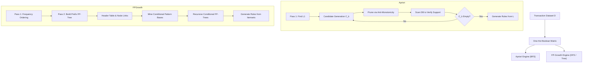
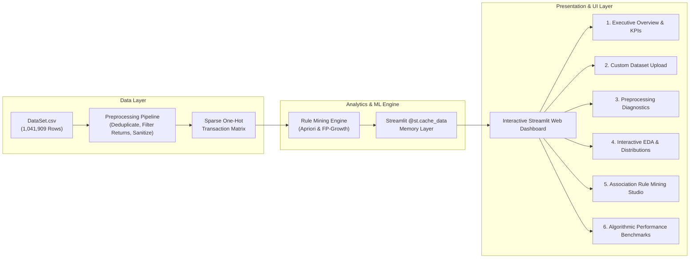

# ML-Based Market Basket Analysis: Architecture, Algorithmic Foundations & System Context

---

## 1. Project Motivation & Business Context

In the modern retail ecosystem—spanning both omni-channel brick-and-mortar storefronts and high-throughput e-commerce platforms—understanding **consumer purchasing behavior** is the single highest leverage point for revenue optimization. 

When consumers shop, their purchase choices are not independent events. Instead, transactions reflect complex decision-making processes governed by complementary utility, household needs, culinary recipes, aesthetic coordination, and impulse triggers. 

### The Core Problem Statement
Traditional retail analytics often relies on siloed, single-item velocity metrics (e.g., top-selling products by volume). This creates severe operational blind spots:
1. **Missed Bundling Opportunities**: Retailers fail to identify natural product affinities, missing out on multi-pack promotions that elevate Average Order Value (AOV).
2. **Suboptimal Store Planograms**: Complementary goods are placed in distant aisles, increasing customer friction and reducing multi-item baskets.
3. **Ineffective Cross-Sell Recommendations**: E-commerce platforms display generic "popular items" rather than context-aware complementary additions during checkout.
4. **Supply Chain Desynchronization**: Stockouts in primary items (e.g., tea sets) inadvertently kill demand for unsponsored complementary items (e.g., saucers).

### The Machine Learning Solution
This project establishes an **end-to-end, unsupervised machine learning platform** for **Market Basket Analysis (MBA)**. By converting high-volume point-of-sale logs into affinity graphs and association rules, the system extracts high-confidence, actionable behavioral rules that directly inform inventory placement, marketing promotions, dynamic bundling, and real-time recommendation engines.

---

## 2. Theoretical & Mathematical Foundations of Association Rule Mining

Association Rule Mining operates over a transaction database $D = \{T_1, T_2, \dots, T_n\}$, where each transaction $T_i$ is a subset of the universal item catalog $I = \{i_1, i_2, \dots, i_m\}$. An **association rule** is an implication of the form:

$$X \implies Y$$

where $X, Y \subset I$ are disjoint itemsets ($X \cap Y = \emptyset$). $X$ is termed the **Antecedent** (the condition or premise), and $Y$ is termed the **Consequent** (the predicted outcome).

The significance, reliability, and economic value of a rule are quantified using five core mathematical metrics:

---

### 2.1 Support (Frequency & Generality)
Support measures how frequently a given itemset or rule appears across the entire corpus of transactions $D$:

$$\text{Support}(X) = \frac{\sigma(X)}{|D|} = P(X)$$

$$\text{Support}(X \implies Y) = \text{Support}(X \cup Y) = \frac{\sigma(X \cup Y)}{|D|} = P(X \cap Y)$$

where $\sigma(X) = |\{T \in D \mid X \subseteq T\}|$ denotes the absolute frequency count. 

- **Interpretation**: Support acts as a significance filter. A rule with negligible support (e.g., 0.0001%) may be pure noise, whereas high-support rules represent broad customer habits.

---

### 2.2 Confidence (Conditional Probability & Reliability)
Confidence measures the conditional probability that a basket contains $Y$ given that it already contains $X$:

$$\text{Confidence}(X \implies Y) = \frac{\text{Support}(X \cup Y)}{\text{Support}(X)} = \frac{P(X \cap Y)}{P(X)} = P(Y \mid X)$$

- **Interpretation**: Confidence reflects rule reliability. A confidence of 0.85 means that 85% of shoppers who placed $X$ into their basket also purchased $Y$.
- **Limitation**: Confidence alone can be deceptive if $Y$ is an overwhelmingly popular baseline item purchased by almost everyone (e.g., milk or bread). This necessitates the Lift metric.

---

### 2.3 Lift (Correlation & Independence Ratio)
Lift measures the degree of statistical dependence between antecedent $X$ and consequent $Y$, normalized by their independent probabilities:

$$\text{Lift}(X \implies Y) = \frac{\text{Confidence}(X \implies Y)}{\text{Support}(Y)} = \frac{P(X \cap Y)}{P(X) \times P(Y)}$$

- **$\text{Lift} = 1$**: $X$ and $Y$ are statistically independent ($P(X \cap Y) = P(X)P(Y)$). Purchasing $X$ has zero effect on purchasing $Y$.
- **$\text{Lift} > 1$**: Positive association. The presence of $X$ significantly accelerates the probability of purchasing $Y$ (complementary items).
- **$\text{Lift} < 1$**: Negative association / Cannibalization. Purchasing $X$ decreases the probability of purchasing $Y$ (substitute items).

---

### 2.4 Leverage (Absolute Margin of Affinity)
Leverage calculates the absolute difference between observed joint occurrence and expected joint occurrence under complete independence:

$$\text{Leverage}(X \implies Y) = \text{Support}(X \cup Y) - \big(\text{Support}(X) \times \text{Support}(Y)\big)$$

- **Interpretation**: Leverage ranges from $[-0.25, 0.25]$. While Lift is relative, Leverage reveals the absolute volume of transactions generated specifically by the synergy between $X$ and $Y$.

---

### 2.5 Conviction (Directional Dependency & Error Ratio)
Conviction measures the ratio of the expected frequency that $X$ occurs without $Y$ if the rule were purely coincidental, divided by the observed frequency of incorrect predictions:

$$\text{Conviction}(X \implies Y) = \frac{1 - \text{Support}(Y)}{1 - \text{Confidence}(X \implies Y)} = \frac{P(X)P(\neg Y)}{P(X \cap \neg Y)}$$

- **Interpretation**: Unlike Lift (which is symmetric), Conviction is directional. A conviction approaching $\infty$ indicates that the consequent $Y$ is never seen without antecedent $X$ (deterministic rule).

---

## 3. Deep Dive into Mining Algorithms

The computational core of the system implements and compares two primary algorithmic paradigms:

---

### 3.1 The Apriori Algorithm (Level-Wise Breadth-First Search)
Pioneered by Agrawal and Srikant (1994), Apriori relies on the **Anti-Monotonicity Property** (the Apriori Principle):

> *"Any subset of a frequent itemset must also be frequent; conversely, any superset of an infrequent itemset cannot be frequent."*

$$\forall A, B \subset I : (A \subseteq B \land \text{Support}(A) < \text{minsup}) \implies \text{Support}(B) < \text{minsup}$$

#### Operational Mechanics
1. **Pass 1 ($k=1$)**: Scan the database to count support for all individual items $C_1$. Prune items below $\text{minsup}$ to produce frequent 1-itemsets $L_1$.
2. **Candidate Generation ($C_k$)**: Generate candidate $k$-itemsets from $L_{k-1}$ using the join operation $L_{k-1} \Join L_{k-1}$, ensuring the first $k-2$ items match.
3. **Pruning Step**: Discard candidates in $C_k$ where any $(k-1)$-subset is not in $L_{k-1}$.
4. **Database Scan**: Scan the database to determine exact counts for candidates in $C_k$.
5. **Termination**: Repeat until no new candidates can be formed.

#### Complexity & Limitations
- **Time Complexity**: Worst-case $O(2^{|I|} \cdot |D|)$. If an itemset has length $k$, Apriori must generate $\sum_{i=1}^k \binom{k}{i} = 2^k - 1$ candidates.
- **I/O Bottleneck**: Requires $k_{\max}$ full passes over the physical database, creating major computational latency on large disks.

---

### 3.2 The FP-Growth Algorithm (Divide-and-Conquer Prefix Tree)
Proposed by Han, Pei, and Yin (2000), **Frequent Pattern Growth (FP-Growth)** eliminates candidate generation entirely by compressing the database into an in-memory **FP-Tree**.

#### Data Structure Anatomy
1. **Header Table**: Contains all frequent 1-items sorted in descending frequency order, with head-of-line pointers linking to their first appearance in the tree.
2. **FP-Tree Nodes**: Each tree node stores `item_id`, `count`, a `parent_pointer`, and a `node_link` connecting identical items across different tree branches.

#### Operational Mechanics
1. **Pass 1**: Scan database once to find frequent 1-items and sort them by descending frequency order.
2. **Pass 2 (Tree Construction)**: Scan database a second time. For each transaction, filter infrequent items, sort items in descending frequency order, and insert the path into the FP-Tree. Shared prefixes overlap, drastically compressing transaction storage.
3. **Mining via Conditional Pattern Bases (CPB)**:
   - For each item in the header table (starting from the least frequent), traverse backwards using parent pointers to collect its **Conditional Pattern Base** (paths ending with that item).
   - Construct a smaller **Conditional FP-Tree** from the pattern base.
   - Recursively mine the conditional tree to extract all frequent patterns.

#### Algorithmic Advantages
- **Only 2 Database Passes**: Drastically cuts disk I/O.
- **Zero Candidate Generation**: No combinatorial explosion.
- **Compact In-Memory Footprint**: Exploits high prefix overlap across retail baskets.

---

## 4. End-to-End System Architecture

### 4.1 Data Cleaning & Hygiene Protocols
1. **Invoice Type Separation**: Invoices starting with the prefix `'C'` (credit notes/cancellations) are isolated from purchase transactions.
2. **Quantity and Unit Price Sanitization**: Rows with $\text{Quantity} \le 0$ or $\text{UnitPrice} \le 0$ (damages, write-offs, system administrative records) are removed.
3. **Noise SKU Elimination**: Non-merchandise stock codes (`POST`, `D`, `M`, `BANK CHARGES`, `AMAZONFEE`) are flagged to prevent false rules.
4. **Description Normalization**: Trim whitespace, uppercase strings, and unify duplicate descriptions with differing casing.

### 4.2 Streamlit Web Application Modules
- **Modular Architecture**: Built using a sleek, single-page application structure with pure black styling (`#000000`), custom responsive navigation, and accessible expand/collapse side rails.
- **State Preservation**: Dynamic parameter exploration (support sliders, confidence sliders, metric pickers) re-evaluates rules instantaneously via cached memory state without re-parsing raw disks.

---

## 5. Technology Stack & Environment

| Component | Library / Framework | Version | Purpose |
| :--- | :--- | :--- | :--- |
| **Language** | Python | `3.14.0` | Core computational runtime |
| **Machine Learning** | `mlxtend` | `0.23.4+` | Vectorized Apriori, FP-Growth, and Association Rule Mining |
| **Data Processing** | `pandas`, `numpy` | `2.2.0+` | Matrix manipulation, vectorization, aggregation |
| **Visualization** | `altair`, `plotly` | `5.0.0+` | Interactive 2D/3D scatter plots, network graphs, bar charts |
| **Web Interface** | `streamlit` | `1.67.0` | Production reactive UI, session state, caching |

---

## 6. Future Architectural Roadmap

1. **Distributed Mining with Spark**: Scale the FP-Growth engine using `pyspark.ml.fpm.FPGrowth` for multi-node cluster execution on transaction datasets exceeding $10^8$ records.
2. **Temporal & Seasonal Rule Decay**: Integrate exponential time-decay weighting to discover seasonal affinities (e.g., Summer outdoor dining vs Winter holiday décor).
3. **Graph Neural Network (GNN) Hybridization**: Train product embedding spaces (e.g., Node2Vec, GraphSAGE) using the mined affinity graph to recommend items across novel, unseen user sessions.
